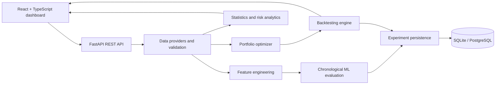

# AlphaForge

AlphaForge is a research-oriented quantitative analytics application for studying whether historical price-derived signals can support portfolio construction. It includes a FastAPI backend, deterministic synthetic data, a yfinance adapter, chronological model evaluation, constrained long-only allocation, cost-aware backtesting, risk metrics, persistence, and a React dashboard.

**Important:** This is an educational research tool, not a trading system or investment advice. Synthetic demo series are labelled synthetic and must never be presented as real market data. Historical backtests are not forecasts.

## Implemented capabilities

- Daily adjusted-price download adapter through yfinance and deterministic synthetic data for offline runs.
- Price validation, duplicate timestamp removal, missingness summary, simple/log returns, rolling momentum, volatility and moving-average gaps.
- Descriptive volatility/correlation analysis and Augmented Dickey-Fuller tests on returns.
- Chronological train/test baseline comparisons: zero-return, Ridge, Random Forest, and histogram gradient boosting; MAE, RMSE, directional accuracy and daily Ridge IC summary.
- Equal-weight, inverse-volatility, minimum-variance and mean-variance allocation with long-only/cap checks.
- Daily portfolio simulation with periodic rebalancing, one-way turnover, transaction costs and slippage; risk-adjusted metrics and optional benchmark.
- SQLAlchemy experiment persistence (SQLite default; PostgreSQL via `DATABASE_URL`).
- Interactive frontend pages for overview, data, alpha research, optimization, backtesting, risk and experiments.
- API docs at `/docs`; unit/API tests.

## Architecture



## Requirements

- Python 3.11+ (tested here with Python 3.13; dependency wheels may vary by platform)
- Node.js 20+
- Optional Docker and Docker Compose
- Network access only if downloading market data or installing packages

## Local setup

### Backend

```bash
cd backend
python -m venv .venv
# Windows PowerShell: .venv\Scripts\Activate.ps1
# macOS/Linux: source .venv/bin/activate
pip install -r requirements.txt
uvicorn app.main:app --reload
```

Open http://localhost:8000/docs. SQLite database defaults to `backend/alphaforge.db` when launched from `backend`.

### Frontend

In a second terminal:

```bash
cd frontend
npm install
npm run dev
```

Open http://localhost:5173. Set `VITE_API_URL` if the API is not at `http://localhost:8000`.

### Run tests

```bash
cd backend
pytest -q
```

### Docker

```bash
docker compose up --build
```

The compose file runs PostgreSQL, API and frontend. To run local SQLite instead, omit `DATABASE_URL`.

## Environment variables

Copy `.env.example` to `.env` and configure values as needed. The backend reads process environment variables; Compose loads `.env`.

- `DATABASE_URL`: default `sqlite:///./alphaforge.db`; Compose uses PostgreSQL.
- `ARTIFACT_DIR`: reserved artifact directory setting.
- `FRONTEND_ORIGINS`: comma-separated allowed browser origins.
- `MAX_ASSETS`: default 50.
- `MAX_HISTORY_DAYS`: configuration placeholder for deployment limits.
- `VITE_API_URL`: frontend API base URL.

## API workflow

1. `GET /health`
2. `GET /api/v1/market-data?data_source=synthetic`
3. `GET /api/v1/statistics`
4. `POST /api/v1/models/train`
5. `POST /api/v1/portfolio/optimize`
6. `POST /api/v1/backtests`
7. `GET /api/v1/experiments`

Example backtest request:

```json
{
  "symbols": ["ASSET_A", "ASSET_B", "ASSET_C", "ASSET_D"],
  "periods": 500,
  "data_source": "synthetic",
  "strategy": "equal_weight",
  "initial_capital": 100000,
  "rebalance_every": 21,
  "transaction_cost_bps": 8,
  "slippage_bps": 2,
  "max_weight": 0.25
}
```

For real market history, use actual Yahoo Finance ticker symbols and `data_source: "yfinance"`. Data provider availability, rate limits, symbol coverage, and corporate-action treatment can change. The adapter requests `auto_adjust=True`, so prices are adjusted by yfinance; verify provider semantics before research use.

## Methodology at a glance

- Returns: simple close-to-close returns, \(r_t=P_t/P_{t-1}-1\); log returns are available as a helper.
- Features: rolling returns, rolling standard deviation and moving-average gap use data through close t. Target is the next row's return, so it is unavailable at feature timestamp t.
- Model split: chronological 60% train / 20% validation / 20% test by distinct date. Scalers/imputers are fitted within the training pipeline. The current comparison does not use validation for hyperparameter selection.
- Optimization: annualized sample mean/covariance, covariance diagonal jitter, SLSQP for constrained variance/mean-variance strategies. Expected return is a noisy estimate, not a forecast guarantee.
- Backtest timing: rebalance decision uses returns through the prior close; portfolio weights earn the following close-to-close return. Costs apply once at rebalance using one-way turnover \(rac12\sum_i|w_i-w_{i,\mathrm{prev}}|\).
- Risk: 252 trading days/year, 2% annual risk-free rate for Sharpe/Sortino, drawdown from running wealth peak. Metrics are sample dependent.

See [docs/methodology.md](docs/methodology.md), [docs/architecture.md](docs/architecture.md), [docs/api.md](docs/api.md), and [docs/limitations.md](docs/limitations.md).

## Demo walkthrough

1. Start backend and frontend.
2. On Overview, run a backtest; note the source badge says synthetic.
3. Change strategy/cost and rerun; compare equity and risk metrics.
4. Open Alpha Research and train models; inspect the chronological test window and baseline table.
5. Open Optimization and inspect weight sum and maximum weight.
6. Open Risk Analytics to inspect correlation.
7. Open Experiments to see saved results.
8. For an interview, explain why a high backtest score alone is not evidence of an alpha signal, and describe costs, point-in-time features, and fixed-universe survivorship bias.

## Resume bullet options

See [docs/resume_bullets.md](docs/resume_bullets.md). Use only claims that match the version you actually run and can explain.

## Known limitations

- No historical index constituent database, so real-data universes may have survivorship bias.
- No true next-open execution data; simulation uses a documented close-to-close convention with decisions based on prior-close data.
- Current backtest costs are charged as a fraction of portfolio return at rebalance; gross and net return series are not both exposed.
- Model metadata/results persist as JSON, but fitted model artifacts are not yet persisted for later inference.
- No background job queue; long-running work executes synchronously with bounded request sizes.
- Sector constraints, cash allocation, Black-Litterman, LSTM, RL, bootstrap confidence intervals and detailed attribution are not implemented.
- yfinance requests require network availability and may fail; synthetic data keeps offline tests reproducible.
- UI's model training request schema reuses optimization configuration for simplicity.

## Disclaimer

AlphaForge is a learning and research project. It does not provide investment advice, guarantee results, or execute trades. Validate data, methodology, legal requirements and risk controls independently before using any research output.
