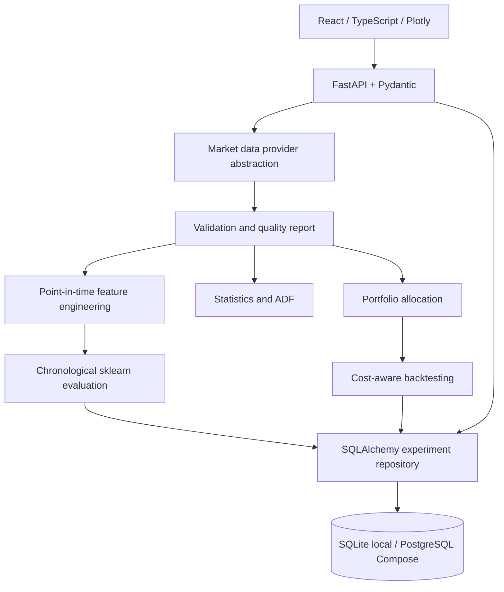

# Architecture

HTTP routes validate inputs and orchestrate services. Feature, model, optimizer, metric, and backtest functions are separate modules. The database stores experiment payloads; large model artifacts are not currently persisted. The yfinance provider is optional at runtime and synthetic data is deterministic for repeatable offline demonstrations.
